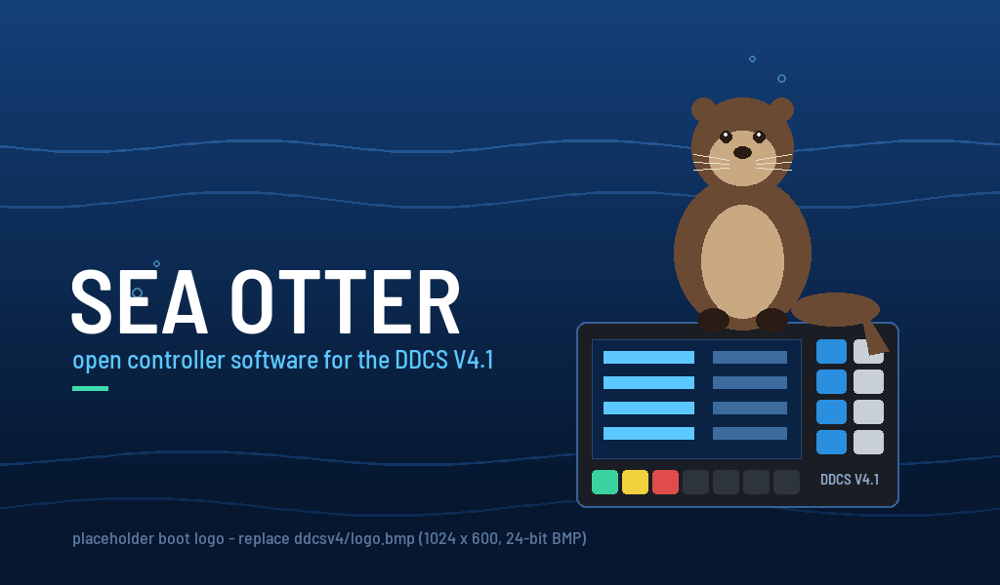

# Boot logo

Sea Otter shows `logo.bmp` from the controller's app folder (`/ddcsv4/logo.bmp`) for about
2 seconds while it starts — the same file and format the vendor software uses for its start
screen. A key press skips it. The one in the package is a **placeholder**
(`app/install/usb/ddcsv4/logo.bmp`, made by `app/install/logo/make-logo.py`); replace it with
your own artwork.

## Format (must match exactly)

| | |
|---|---|
| Size | **1024 × 600 px** (the panel; aspect 128:75 ≈ 1.71:1) |
| File | Windows **BMP, 24-bit, uncompressed** (bottom-up or top-down) — e.g. GIMP *Export As → .bmp*, "24 bits R8 G8 B8"; Paint *Save as → 24-bit Bitmap*; Photoshop *BMP, 24 Bit* |
| Name | `logo.bmp` |
| Display | the panel is 16-bit (RGB565); Sea Otter dithers the image when it loads it, so smooth dark gradients don't band |

Anything else (wrong size, 32-bit, compressed, PNG renamed to .bmp) is ignored: Sea Otter just
starts without a logo. The packaging script refuses to build a package with a logo in the wrong
format.

**To replace it:** put your `logo.bmp` in `app/install/usb/ddcsv4/` and commit it — every build
after that ships it. Or, on one controller only: copy just `logo.bmp` into a `ddcsv4` folder
on a USB stick and boot once.

## Image-generator prompt (Sea Otter on the DDCS V4.1)

Most image generators can't produce 1024 × 600 directly. Generate at **16:9** (e.g. 1920 × 1080)
or **5:3** and crop to **128:75** — keep the important part inside the central ~90 % so the crop
doesn't cut it. They also misspell lettering: generate the picture **without text** and add
"SEA OTTER" yourself (the panel uses *Barlow Semi Condensed SemiBold*, in `app/tools/fonts/`).

### Main prompt — marine blue (matches the current display)

> A wide 16:9 illustration for the start screen of an industrial CNC controller. A calm deep-sea
> scene at night: a dark marine-blue ocean background, a smooth vertical gradient from deep navy
> **#06172F** at the bottom to ocean blue **#14407A** near the top, with faint, soft light rays
> from the surface and a few small bubbles. On the right third of the image, a friendly, realistic
> **sea otter sitting upright on top of a compact black CNC motion-controller box**: a dark
> charcoal (#1A1E24) front panel with a 7-inch screen showing glowing cyan (#5CC8FF) readout
> lines, a block of square rounded keys on the right (blue keys and light-grey arrow keys), and a
> row of small keys along the bottom — a green, a yellow and a red key, then black keys. The otter
> rests its front paws on the top edge of the controller, curious and calm, wet brown fur with a
> lighter face, looking slightly toward the viewer. Cool cyan rim light on the otter and the
> controller edges, subtle teal (#3DDBB0) highlights in the water. The left half of the image is
> calm, dark, uncluttered open water (space for a title). Clean, modern, slightly stylised
> digital illustration, crisp shapes, high contrast, no text, no watermark, no logos.

*Negative prompt (if your generator has one):* text, letters, words, watermark, signature,
brand logo, cluttered background, bright sky, beach, sunlight, harsh noise, film grain,
oversaturated, cartoonish proportions, extra limbs.

### Alternative colour styles

The same scene, with a different palette. Each comes with the colours the panel UI would use
(background gradient / accent / highlight / warning), so a later display theme can follow the
same choice. Replace the colour sentence of the main prompt with the one given.

| Style | Prompt colours | UI palette (BG0 → BG1 · accent · highlight · warn) | When |
|---|---|---|---|
| **Marine** (current) | "deep navy #06172F to ocean blue #14407A, cyan #5CC8FF screen glow, teal #3DDBB0 water highlights" | #14407A → #06172F · #5CC8FF · #3DDBB0 · #FFB547 | the default; the name came from it |
| **Kelp forest** | "dark teal-green water #041F1E to #0E4A44, tall silhouettes of kelp in the background, seafoam #7FE0C4 screen glow, warm amber #FFB547 rim light" | #0E4A44 → #041F1E · #7FE0C4 · #3E9D6E · #FFB547 | calmer, greener; less blue light |
| **Night shift** | "near-black water #0B0B0C to dark bronze #1C1A17, only a faint amber #FFB547 glow from the controller screen lighting the otter, deep shadows" | #1C1A17 → #0B0B0C · #FFB547 · #FF8A3D · #FF5D5D | dark workshops; amber is easy on night vision |
| **Arctic** | "light ice-blue water #EEF3F7 to steel blue #9FB8CF, the otter on an ice floe beside the controller, slate #2B3A4A details, steel-blue #3A6EA5 screen" | #EEF3F7 → #D5E0EA (light UI, dark text #2B3A4A) · #3A6EA5 · #2E9C8F · #D9822B | bright workshops, sunlight on the screen |
| **Sunset coast** | "dusky violet water #1B1033 to plum #5A2A55, warm coral #FF7A59 and gold #FFC857 sunset reflections on the surface, cyan screen glow" | #5A2A55 → #1B1033 · #FF7A59 · #FFC857 · #FF5D5D | warmer, more playful |

Tips for the panel: keep the background **dark** in the dark styles (the LCD has a narrow
viewing angle and dark backgrounds read best), give the otter and the controller strong edges
(they're seen from a metre away), and avoid fine textures, which the 16-bit panel turns into
noise.
